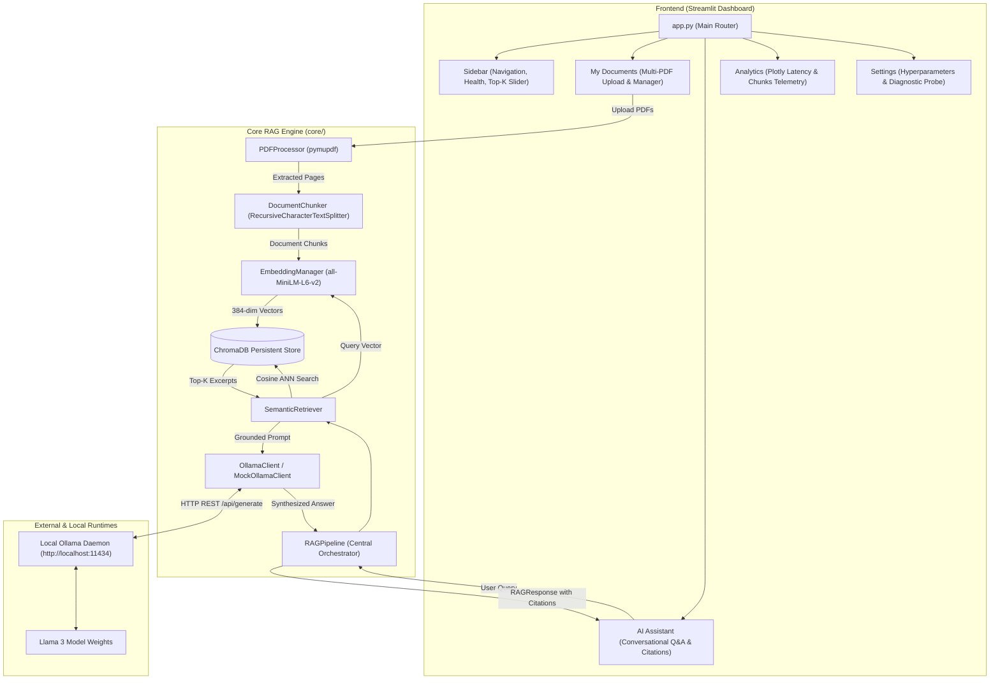
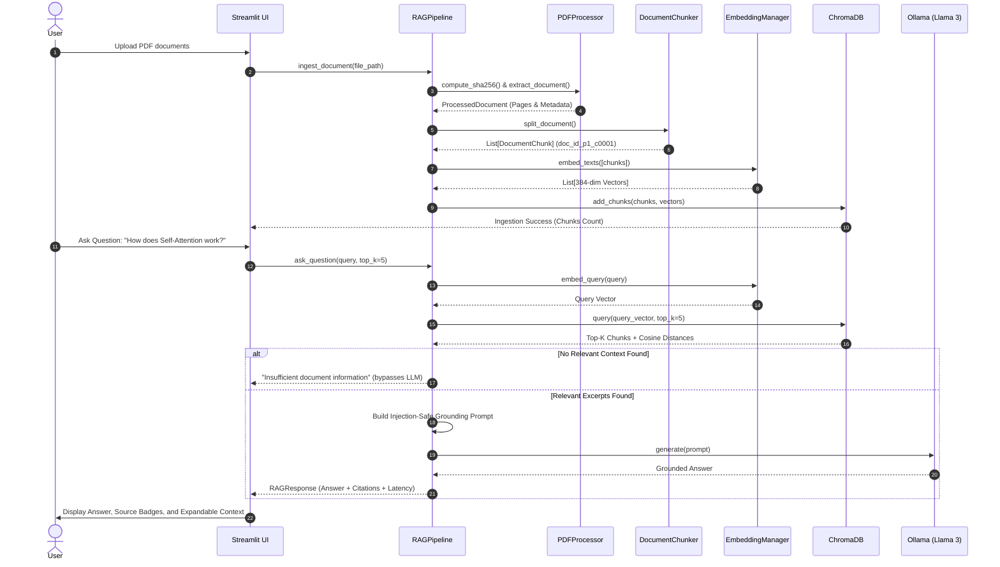

# DocuMind AI – Multi-Document RAG Assistant

[](https://shawrabi07-documind-ai-app-rgrjey.streamlit.app/)
[](LICENSE)
[](https://www.python.org/)

> 🚀 **Live Web Application**: [https://shawrabi07-documind-ai-app-rgrjey.streamlit.app/](https://shawrabi07-documind-ai-app-rgrjey.streamlit.app/)

DocuMind AI is a production-style Retrieval-Augmented Generation (RAG) assistant that allows users to upload, index, cross-examine, and converse with multiple PDF documents simultaneously. It combines **PyMuPDF**, **Sentence Transformers**, **ChromaDB**, and **Llama 3** (via local **Ollama**) inside a modern **Streamlit** dashboard.

Every answer is strictly grounded in the verified text of the uploaded documents and comes with explicit, page-level source citations and empirical latency telemetry.

---

## 1. Problem Statement

Standard Large Language Models (LLMs) suffer from two core limitations when analyzing private or technical documents:
1. **Hallucinations & Ungrounded Claims**: General LLMs invent facts or confidently misquote specifications when the document content is not in their training data.
2. **Context Window & Recency Bottlenecks**: Feeding entire 100-page manuals or textbooks directly into an LLM context window is computationally expensive, slow, and leads to "lost in the middle" attention degradation.

**DocuMind AI** solves this through a modular Retrieval-Augmented Generation (RAG) architecture:
- Documents are parsed into clean text and sliced into semantically cohesive, page-traceable chunks.
- Chunks are transformed into 384-dimensional dense vectors and stored in an on-disk ChromaDB HNSW vector index.
- When a user asks a question, only the top-$K$ most mathematically relevant document excerpts are retrieved and injected into a strict grounding prompt.
- Llama 3 answers the question using **only** the provided evidence, citing the exact document name, page number, and chunk relevance score.

---

## 2. Key Implemented Features

* **Multi-PDF Document Processing**: Upload multiple PDFs simultaneously with drag-and-drop validation and up to 25 MB per file limits.
* **Deterministic SHA-256 Deduplication**: Calculates file hashes to prevent redundant processing and duplicate vector storage.
* **Page-Aware Chunking**: Uses LangChain's `RecursiveCharacterTextSplitter` configured on page boundaries to ensure 100% accurate page citations.
* **Dense Vector Embeddings**: Uses `sentence-transformers/all-MiniLM-L6-v2` with singleton caching, fast batch inference, and unit-normalized vectors.
* **ChromaDB Persistent Storage**: Native on-disk storage using SQLite and HNSW indexing with cosine distance metrics.
* **Semantic Retrieval with Cosine Normalization**: Maps distance values $d \in [0, 2]$ to intuitive similarity percentages and applies distance thresholding.
* **Local Llama 3 Inference via Ollama**: Direct HTTP REST integration with active health checks, connection error handling, and model verification.
* **Strict Grounding Prompting**: System prompt strictly commands the LLM never to extrapolate, treat document excerpts as untrusted references, and declare insufficient information when context is absent.
* **Built-in Mock LLM Testing Mode**: Toggle in the sidebar to test full conversational workflows, citations, and analytics without needing an active GPU or Ollama daemon.
* **Expandable Context Inspector**: View the exact chunk text, cosine distance, and source metadata passed to the LLM.
* **Real Latency Telemetry**: Empirically measures vector retrieval latency (ms) and LLM generation latency (ms)—no fake or hardcoded statistics.
* **Plotly Analytics Dashboard**: Visualizes chunk distributions per document, query execution sequences, and stacked latency breakdowns.
* **Cascading Document Deletion**: One-click deletion of indexed documents and all associated vector embeddings from ChromaDB.

---

## 3. Technology Stack

| Component | Technology | Purpose |
| :--- | :--- | :--- |
| **Language** | Python 3.11.9 | Core programming runtime. |
| **PDF Extraction** | PyMuPDF (`pymupdf` 2.1) | C-accelerated, high-speed text and layout extraction from PDFs. |
| **Chunking** | `langchain-text-splitters` | Hierarchical recursive character splitting with configurable size and overlap. |
| **Embedding Model** | `sentence-transformers` (all-MiniLM-L6-v2) | 384-dimensional dense vector embeddings with small memory footprint (~80 MB). |
| **Deep Learning** | PyTorch (`torch` 2.15 CPU) | Underlying tensor computation backend for transformer embeddings. |
| **Vector Database** | ChromaDB (`chromadb` 0.6.3) | Embedded, persistent vector store using HNSW graphs for $O(\log N)$ nearest-neighbor search. |
| **Alternative Store** | FAISS (`faiss-cpu` 1.16) | Optional secondary vector store backend. |
| **Local LLM Engine** | Ollama (Llama 3 8B) | Local, privacy-focused open-weight LLM execution. |
| **HTTP Client** | HTTPX (`httpx` 0.28) | High-speed REST communication with the Ollama daemon. |
| **Frontend UI** | Streamlit (`streamlit` 1.67) | Interactive web dashboard with custom dark-navy CSS styling. |
| **Visualizations** | Plotly (`plotly` 7.1) | Interactive vector distribution charts and latency telemetry plots. |
| **Testing** | Pytest (`pytest` 9.2) | 29-test automated test suite covering unit, integration, and UI modules. |

---

## 4. Architecture Diagram



---

## 5. End-to-End RAG Workflow



---

## 6. Project Folder Structure

```text
DocuMindAI/
├── app.py                          # Streamlit application entry point
├── requirements.txt                # Version-pinned Python dependencies
├── README.md                       # Comprehensive project documentation
├── TECHNICAL_INTERVIEW_QA.md       # 30 detailed interview questions & answers
├── LICENSE                         # MIT open-source license
├── .env.example                    # Environment variable configuration template
├── .env                            # Active environment configuration
├── .gitignore                      # Git exclusion rules
│
├── config/
│   ├── __init__.py
│   └── settings.py                 # Centralized settings & hyperparameter validation
│
├── core/
│   ├── __init__.py
│   ├── pdf_processor.py            # PyMuPDF text extraction & SHA-256 hashing
│   ├── text_splitter.py            # LangChain page-aware chunking engine
│   ├── embeddings.py               # Sentence Transformers 384-dim embedding manager
│   ├── vector_store.py             # ChromaDB persistent storage & BaseVectorStore
│   ├── retriever.py                # Semantic retriever & distance scoring
│   ├── llm.py                      # Local Ollama client & MockOllamaClient
│   └── rag_pipeline.py             # Unified end-to-end RAG orchestrator
│
├── utils/
│   ├── __init__.py
│   ├── helpers.py                  # Sanitization, byte formatting & deduplication
│   └── metrics.py                  # Real empirical query latency tracker
│
├── components/
│   ├── __init__.py
│   ├── sidebar.py                  # Sidebar navigation, health check & sliders
│   ├── chat_interface.py           # Chat UI, citation cards & context inspector
│   └── analytics.py                # Plotly latency telemetry & chunk distributions
│
├── data/
│   ├── uploads/                    # Uploaded user PDF files (.gitkeep)
│   ├── chroma_db/                  # Persistent on-disk vector database (.gitkeep)
│   └── sample_docs/                # Sample demonstration PDF documents:
│       ├── Deep_Learning_Architectures.pdf
│       └── Quantum_Computing_Principles.pdf
│
├── tests/
│   ├── __init__.py
│   ├── test_pdf_processor.py       # Unit tests: extraction, empty & corrupt files
│   ├── test_embeddings.py          # Unit tests: 384-dim validation & batching
│   ├── test_retriever.py           # Unit tests: ChromaDB, ranking & deletions
│   ├── test_rag_pipeline.py        # Integration tests: end-to-end RAG pipeline
│   ├── test_frontend.py            # Unit tests: UI helpers & metrics tracker
│   └── demonstration_workflow.py   # Automated 10-step full system validation script
│
└── assets/
    └── style.css                   # Modern dark-navy SaaS custom stylesheet
```

---

## 7. Windows Installation & Setup Guide

### Step 1: Open Windows PowerShell & Navigate to Workspace
```powershell
cd C:\path\to\DocuMindAI
# Or if already in the folder:
cd .
```

### Step 2: Create Python Virtual Environment (Python 3.11.9)
```powershell
python -m venv .venv
```

### Step 3: Activate the Virtual Environment
```powershell
.\.venv\Scripts\Activate.ps1
```
*(If PowerShell restricts script execution, run `Set-ExecutionPolicy -Scope CurrentUser -ExecutionPolicy RemoteSigned` first).*

### Step 4: Upgrade Pip and Install Dependencies
```powershell
python -m pip install --upgrade pip
pip install -r requirements.txt
```

### Step 5: Verify Environment & Package Imports
```powershell
python -m pip check
pytest -v tests/
```

---

## 8. Ollama Installation & Llama 3 Setup

1. **Download Ollama for Windows**:
   Download and run the Windows installer from [ollama.com/download/windows](https://ollama.com/download/windows).
2. **Start the Ollama Application**:
   Ensure the Ollama icon appears in your Windows system tray.
3. **Pull the Llama 3 Model**:
   Open a terminal and run:
   ```powershell
   ollama pull llama3
   ```
4. **Verify Ollama is Running**:
   In PowerShell, run:
   ```powershell
   curl http://localhost:11434/api/tags
   ```
   You should see a JSON response listing `llama3:latest`.

> **Testing Mode (No Ollama Required)**:
> If Ollama is not installed or your machine does not have a dedicated GPU, you can still run and evaluate the complete system. In the Streamlit sidebar, enable **"Use Mock LLM (Testing Mode)"**. All vector indexing, semantic search, citations, and analytics will execute normally with simulated LLM generation.

---

## 9. Environment Configuration

Copy the example configuration to create your local `.env`:
```powershell
Copy-Item .env.example .env
```

Default `.env` configuration:
```ini
# Ollama settings
OLLAMA_BASE_URL=http://localhost:11434
OLLAMA_MODEL=llama3

# Embedding model
EMBEDDING_MODEL=sentence-transformers/all-MiniLM-L6-v2

# Storage paths
CHROMA_PERSIST_DIR=data/chroma_db
UPLOAD_DIR=data/uploads

# Hyperparameters
CHUNK_SIZE=1000
CHUNK_OVERLAP=200
TOP_K=5

# Vector store backend ("chroma" or "faiss")
VECTOR_STORE_BACKEND=chroma
```

---

## 10. Running the Application

Launch the Streamlit web dashboard:
```powershell
.\.venv\Scripts\streamlit.exe run app.py
```

The application will start and automatically open in your default browser at:
```text
http://localhost:8501
```

---

## 11. Automated Demonstration & Verification Script

DocuMind AI includes an automated 10-step validation script that exercises every core component:
```powershell
python tests/demonstration_workflow.py
```

This script automatically:
1. Ingests two sample PDFs (`Deep_Learning_Architectures.pdf` and `Quantum_Computing_Principles.pdf`).
2. Confirms chunk counts and page metadata.
3. Asks a question about Document 1 (Self-Attention mechanism).
4. Asks a question about Document 2 (Grover's algorithm).
5. Asks a cross-document synthesis question.
6. Verifies exact source document citations and page numbers.
7. Asks an unrelated question (cookie recipe) and verifies insufficient-context handling.
8. Tests duplicate file rejection.
9. Deletes Document 1 and verifies that its vector chunks are purged from ChromaDB.
10. Prints the measured query latency audit summary.

---

## 12. Running Unit Tests

Run the full automated test suite with pytest:
```powershell
.\.venv\Scripts\pytest.exe -v tests/
```
All **29 unit and integration tests** will execute and pass in approximately 16 seconds.

---

## 13. UI Walkthrough & Screenshot Placeholders

### 1. Home Dashboard
*Displays system health, vector database totals, active model specifications, and quick onboarding cards.*
```text
+-----------------------------------------------------------------------------------+
| 🧠 DocuMind AI – Multi-Document RAG Assistant                                     |
| [ Total Documents: 2 ]  [ Total Chunks: 4 ]  [ Model: MiniLM ]  [ LLM: Llama 3 ]  |
+-----------------------------------------------------------------------------------+
```

### 2. Document Management View
*Multi-PDF drag-and-drop uploader with real-time indexing progress and document deletion table.*
```text
+-----------------------------------------------------------------------------------+
| 📤 Upload New Documents [ Browse Files (PDF) ]                                    |
| [⚡ Index Uploaded Documents]                                                     |
| --------------------------------------------------------------------------------- |
| 📄 Deep_Learning_Architectures.pdf   | 2 chunks | 2 pages | [🗑️ Delete]           |
| 📄 Quantum_Computing_Principles.pdf  | 2 chunks | 2 pages | [🗑️ Delete]           |
+-----------------------------------------------------------------------------------+
```

### 3. AI Assistant Chat Stream
*ChatGPT-style conversational interface with verifiable source citations and expandable context inspector.*
```text
+-----------------------------------------------------------------------------------+
| User: How does Self-Attention compute attention weights?                          |
|                                                                                   |
| Assistant: Attention weights are calculated as softmax(Q * K^T / sqrt(d_k)) * V...|
|                                                                                   |
| 📌 Verifiable Source Citations:                                                   |
| 📄 Deep_Learning_Architectures.pdf — Page 1 (Chunk #0) | Relevance: 75.2%         |
|                                                                                   |
| [🔍 Inspect All 4 Retrieved Document Chunks]                                      |
| [⚡ Retrieval: 16.9 ms | 🤖 Generation: 50.0 ms | ⏱️ Total: 66.9 ms]               |
+-----------------------------------------------------------------------------------+
```

### 4. Telemetry & Analytics Dashboard
*Real-time Plotly charts showing vector distributions and empirical retrieval vs. generation latency breakdowns.*
```text
+-----------------------------------------------------------------------------------+
| [ Avg Retrieval: 16.1 ms ]  [ Avg LLM: 50.0 ms ]  [ Queries Recorded: 4 ]         |
| [ Plotly Bar Chart: Chunks per Document ] [ Plotly Stacked Bar: Latency Breakdown ]|
+-----------------------------------------------------------------------------------+
```

---

## 14. Troubleshooting

* **Issue: `ollama` is not recognized as a cmdlet or program**
  * *Solution*: Download and install Ollama from [ollama.com](https://ollama.com). Restart PowerShell so the updated `PATH` environment variable takes effect.
* **Issue: `Model 'llama3' not found in Ollama`**
  * *Solution*: Open terminal and run `ollama pull llama3`. Wait for the 4.7 GB model download to complete.
* **Issue: Port 11434 connection refused**
  * *Solution*: Ollama is not running in the background. Start the Ollama desktop app, or toggle **"Use Mock LLM (Testing Mode)"** in the sidebar to test offline.
* **Issue: `WinError 10013: socket access forbidden`**
  * *Solution*: Check your Windows Defender Firewall or VPN settings to ensure local loopback connections on `localhost:8501` and `localhost:11434` are allowed.

---

## 15. Limitations & Future Roadmap

* **Scanned PDFs & OCR**: Currently, image-only scanned PDFs are detected and flagged with a warning ("OCR required"). Future versions will integrate Tesseract OCR or PaddleOCR for rasterized documents.
* **Reranking**: Adding a cross-encoder reranker (e.g. `bge-reranker-large`) after initial bi-encoder vector retrieval to boost Top-3 precision on complex documents.
* **Document Chunk Previews**: Visual rendering of the original PDF page thumbnail with highlighted bounding boxes around retrieved paragraphs.
* **Streaming Responses**: Real-time token streaming via server-sent events (SSE) from Ollama to Streamlit for faster perceived time-to-first-token.

---

## 16. License

This project is licensed under the MIT License – see the [LICENSE](LICENSE) file for details.
